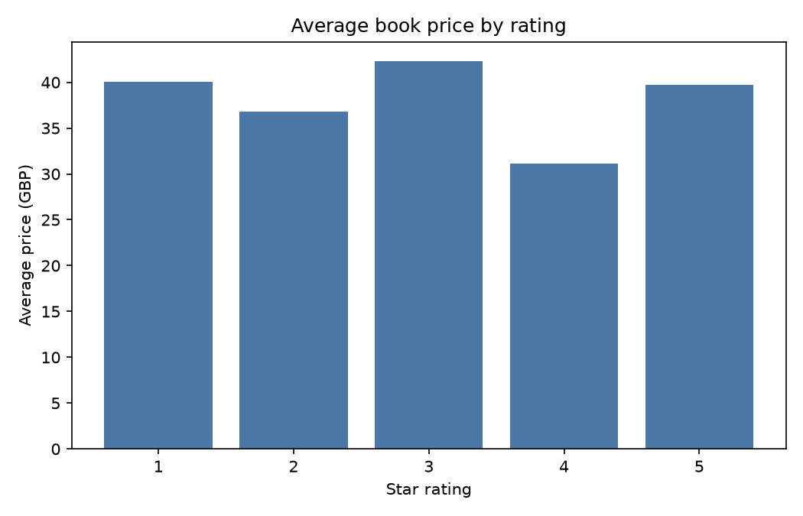

# Books catalogue: AI-assisted structured extraction

This project collects a small, reproducible sample from [Books to Scrape](https://books.toscrape.com/) and turns each book's messy product description into structured fields. The extraction step can use an OpenAI-compatible LLM API, while the default mode uses a local heuristic so the checked-in output can be regenerated without credentials.

## Source and method

- **Source:** Books to Scrape catalogue, `https://books.toscrape.com/`
- **Method:** `scripts/extract_books.py` fetches catalogue pages with a browser-like user agent, waits between requests, parses title, price, rating, availability, and description, then sends the description to an LLM when `OPENAI_API_KEY` and `--use-llm` are supplied. Without an API key it uses a transparent local fallback.
- **Row count:** 20 books in `data/books_structured.csv` (the default `--pages 1` sample).
- **Output fields:** title, price_gbp, rating, availability, description, category, audience, themes, suspicious_flags, extraction_method.

I checked the site's terms and requested `robots.txt` (the endpoint currently responds `404 Not Found`, so there is no published robots policy to interpret), and scraped politely with delays between requests. This project uses a small sample and does not crawl beyond the requested pages.

## Run it

```powershell
python scripts/extract_books.py --pages 1 --output data/books_structured.csv
python scripts/make_chart.py --input data/books_structured.csv --output artifacts/price_by_rating.png
```

For AI extraction, set an API key and optionally an OpenAI-compatible base URL:

```powershell
$env:OPENAI_API_KEY = "your-key"
python scripts/extract_books.py --pages 1 --use-llm
```

The API response is constrained to JSON and is checked against the validation rules in `scripts/extract_books.py`. Suspicious values are retained in `suspicious_flags` rather than silently discarded. The request sends only the public book description and uses a low temperature for repeatability.

## Validation checks run

- required fields are present;
- price is numeric and non-negative;
- rating is an integer from 1 to 5;
- availability is non-negative;
- category is non-empty;
- LLM fields use the expected types (`audience` string, `themes` list);
- suspicious values are explicitly flagged (missing description, unexpected price/rating, and malformed LLM output);
- output row count is checked after writing.

## Chart



The chart shows the average listed price by star rating for the 20-row output.
"# Small-add-on-AI-assisted-extraction" 
